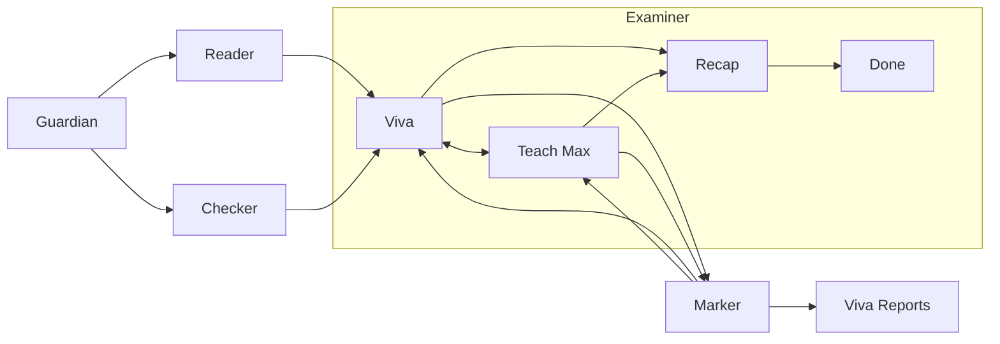

# Socratic

**Don't ban AI. Check understanding.**

Socratic checks whether students can explain the ideas in their own coursework through rubric feedback, practice and a short viva. Lecturers see quoted evidence and areas to discuss, then make the final academic decision.

> **About this repository.** This is Sam Stewart's continuation of Socratic, the team project built at GreatUniHack 2026 (original team repo: [HamidZ11/least-privilege-guh](https://github.com/HamidZ11/least-privilege-guh); team credited below; commit history preserved). It adds a redesign based on `design/refs/designresearch.md`, a working voice conversation (ElevenLabs with a browser-voice fallback, hands-free turns) and a plan for a talking-tutor avatar in `design/refs/talking-tutor-plan.md`.

### Quick start on Windows (PowerShell)

```powershell
copy .env.example .env          # then add ANTHROPIC_API_KEY (and optionally ELEVENLABS_API_KEY)
cd backend
py -3.11 -m venv .venv
.venv\Scripts\Activate.ps1
pip install -r requirements.txt
$env:SEED_DEMO="1"; uvicorn app.main:app --port 8000
```

In a second terminal:

```powershell
cd frontend
copy .env.local.example .env.local
npm install
npm run dev                     # open http://localhost:3000
```

No keys? Set `NEXT_PUBLIC_DEMO_OFFLINE=1` in `frontend/.env.local` and the frontend runs on its built-in demo data without the backend. Voice still works using the browser's own voice.

Originally built by the team below at [GreatUniHack 2026](https://greatunihack-2026.devpost.com), University of Manchester, on 7 November 2026 for Reply's **AI on Campus** challenge.

## The problem

- AI-written coursework can make it harder to tell what a student understands.
- Unreliable detectors and the fear of false accusations can undermine trust between students and lecturers.
- Individual vivas take time and are difficult to offer across a whole class.

## What it does

### Student

- **Brief:** answers supported questions with a quotation from the brief; groups unanswered questions for a lecturer to clarify.
- **Submit work → Rubric Check:** analyses coursework against the module rubric, with red, amber or green criteria and quoted gap notes, without awarding a mark.
- **Teach Max:** practise by correcting a fellow-student persona who confidently repeats a misconception from the work; a sound explanation turns the concept green.
- **Viva:** answer questions quoting your own sentences, by voice or typing, with follow-ups when an answer is vague and revision points at the end.
- **My progress:** view concept colours from weekly labs and your submission, with links back to practice; initial lab examples are labelled seed data.

### Lecturer

- **Student questions:** review grouped questions the brief cannot answer, then write one clarification for the students in that group.
- **Weekly labs:** add lab topics and notes for practice; publishing is stored in this browser for the demo.
- **Viva Reports:** inspect rubric colours, concept status and quoted flags, then record a human decision for a completed submission in the same browser.
- **Class insights:** see concept counts across red, amber and green, combining the demo cohort with current sessions, alongside unanswered brief questions.
- **AI agents & audit log:** inspect agent call counts and recorded activity, including Guardian input scans, blocked outputs and escalations.

## How it works



After Guardian scans the submission, concept extraction and the rubric-reading/checking path run in parallel. Marker supplies the result, while Examiner controls the conversation.

- **Guardian:** removes detected prompt-injection instructions, checks generated replies and records safety events.
- **Reader:** extracts concepts, claims and submission quotations, and reads the rubric criteria.
- **Checker:** gives each rubric criterion a colour, a gap note and supporting evidence from the work.
- **Examiner:** asks questions, follows up vague answers, plays Max and manages the recap.
- **Marker:** checks each answer's understanding of a concept and supplies a colour, confidence and any evidence flag.

Answers are scored before they are stored in the transcript, so a scoring failure does not leave a half-saved answer. The mode machine supports `viva → teach_max → viva → recap → done`; Max can also be opened separately for practice.

Human-in-the-loop escalation applies to brief questions: when the brief does not support an answer, the question goes to the lecturer queue. The lecturer's clarification is then shown to the students in that group.

## Trust & safety

- Guardian strips detected prompt-injection instructions before submission analysis. The demo essay contains a hidden instruction asking for every concept to be marked green; it is removed and flagged.
- Completed agent calls are logged with fixed descriptions rather than student work or names. Guardian also records input scans, output checks, blocks and escalations.
- Examiner and Max replies pass through output guardrails; unsupported accusations, arbitrary grades and other blocked content are replaced with a neutral response.
- Flags contain quoted evidence and neutral descriptions, not verdicts. Correcting a misconception is treated as learning.
- A person makes the final call. Colours and model confidence do not establish authorship or determine an academic outcome.

## Tech

- **FastAPI** and Pydantic for the API and structured validation.
- **Next.js App Router**, React and **Tailwind CSS** for the interface.
- **Anthropic Claude** through the Python SDK; Checker and Marker use Sonnet by default, with the other agents using `MODEL`.
- **ElevenLabs TTS** for Examiner and Max, with memory and disk caches; captions and typed answers remain available when speech is unavailable.
- Browser speech recognition for spoken answers, where the browser supports it.

## Run it locally

Needs Python 3.11+ and Node 20.9+ with npm. Start in the repo root:

```bash
cp .env.example .env
```

Edit the root `.env` locally: set `ANTHROPIC_API_KEY`, `ELEVENLABS_API_KEY` and a `MODEL` available to your Anthropic account. Checker and Marker default to `claude-sonnet-5-5`; `JUDGE_MODEL` can override that. Keep credentials out of Git and the frontend environment.

Backend, at http://localhost:8000:

```bash
cd backend
python3 -m venv .venv
source .venv/bin/activate
pip install -r requirements.txt
SEED_DEMO=1 uvicorn app.main:app --port 8000
```

Frontend, in a second terminal from the repo root, at http://localhost:3000:

```bash
cd frontend
cp .env.local.example .env.local
npm install
npm run dev
```

The frontend example sets `NEXT_PUBLIC_API_URL=http://localhost:8000`. Leave `NEXT_PUBLIC_DEMO_OFFLINE` unset for real API calls. API documentation is at http://localhost:8000/docs; `/health` lists any active stubs. An empty `stubs` list confirms implementations are loaded, but does not check provider credentials or availability.

`SEED_DEMO=1` adds example student reports. Backend sessions and the brief queue live in memory and reset when the server restarts; use one backend worker. Labs, notifications and lecturer decisions use browser storage in this prototype. It has no authentication; use the supplied sample material for the local demo.

### Demo walkthrough

1. Open the student view, which uses **Aisha Khan**. In **Brief**, ask whether references count towards the word limit to create a lecturer escalation.
2. In **Submit work**, open the final piece and upload `backend/app/agents/samples/mock_essay.txt`. The screen supplies the module rubric, matching `backend/app/agents/samples/mock_rubric.txt`.
3. Inspect **Rubric Check**: the sample is intended to show Critical analysis red, Methods amber, Sources red and Presentation amber. Check the Guardian injection flag and the supporting quotations.
4. Open **Teach Max** on the submission and explain why a large sample does not establish causation. Complete the **Viva** with spoken or typed answers, then inspect the recap and **My progress**.
5. Switch to the lecturer view. Inspect Aisha's **Viva Report**, **Class insights** and the **AI agents & audit log**; answer the reference-count question in **Student questions** and return to Brief to see the clarification.

To submit both sample files directly through the API as Aisha Khan, run this from the repo root:

```bash
curl --fail-with-body http://localhost:8000/api/submit \
  -F 'student=Aisha Khan' \
  -F 'work_file=@backend/app/agents/samples/mock_essay.txt' \
  -F 'rubric_file=@backend/app/agents/samples/mock_rubric.txt'
```

This returns a session ID and creates a report. For the complete browser walkthrough, submit through the screen so the browser also holds that session. To run the HTTP smoke test, use `python -m app.agents.scripts.smoke_test` from `backend/` with its virtual environment active and the backend running.

## Team

| Name | GitHub | Role |
|---|---|---|
| Hamid Aziz | [HamidZ11](https://github.com/HamidZ11) | Lead, agents & backend |
| Sam Stewart | [TheSamStewart](https://github.com/TheSamStewart) | Frontend |
| Noumaan Syed | [noumxan](https://github.com/noumxan) | Guardian, Brief, pitch |
| Ebube Onwuzurigbo | [ebubeonwuzurigbo-spec](https://github.com/ebubeonwuzurigbo-spec) | Backend, TTS, seed data, QA |

## AI tools used

- **Claude (Anthropic API):** inside the product.
- **Claude Code, OpenAI Codex and Cursor:** coding assistants during the hackathon.

## What's next

- Moodle and Canvas integration.
- Reference checking.
- Multilingual vivas.
- A UK-hosted model option.
